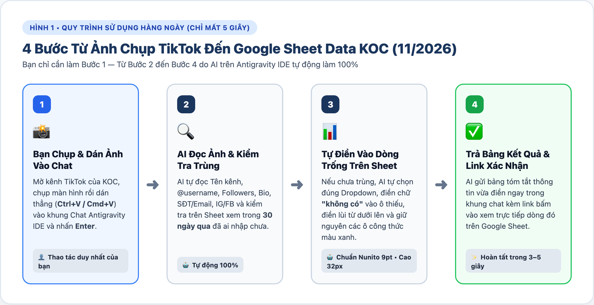
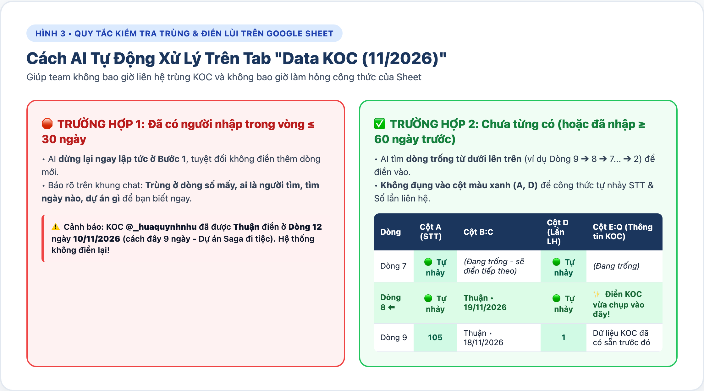
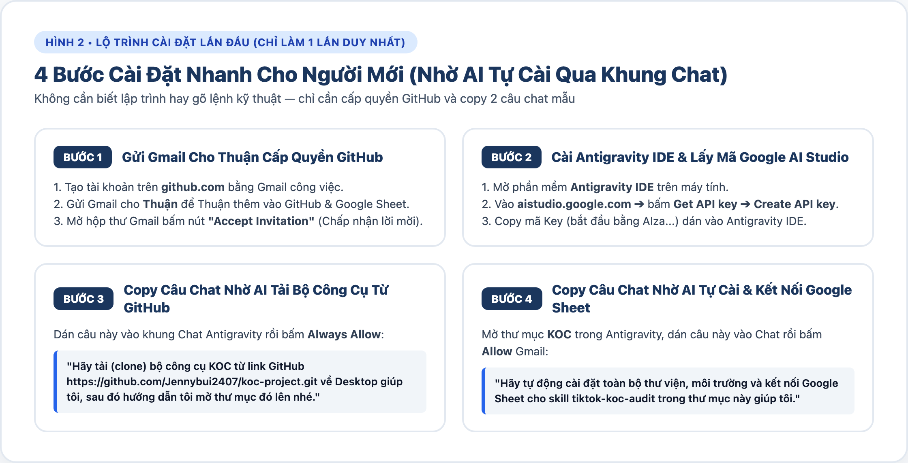
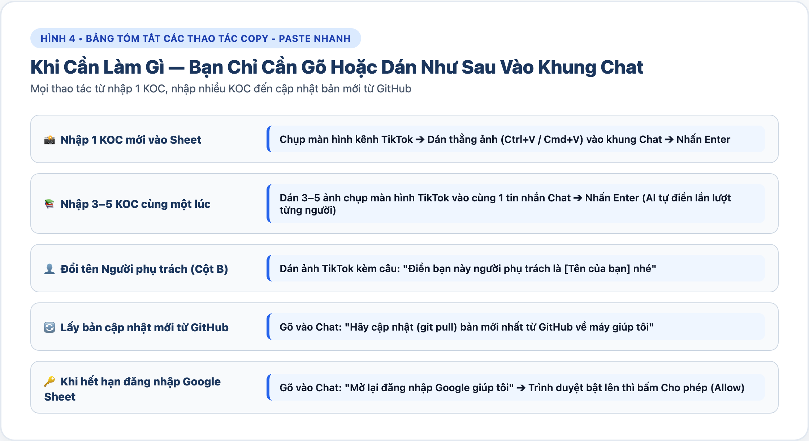

# 🚀 KOC Campaign Automation & Skill TikTok KOC Audit (`tiktok-koc-audit`)

Hệ thống tự động hóa tìm kiếm, kiểm tra trùng lặp, nhập dữ liệu KOC từ ảnh chụp màn hình TikTok và quản trị chiến dịch KOC trên **Antigravity IDE** tích hợp **Google Workspace (Sheets, Docs, Drive, Gmail)**.

* 📄 **Tài liệu hướng dẫn trực tuyến (Google Docs - kèm Thẻ 2 Hình ảnh quy trình)**: [Mở Hướng dẫn cài đặt và sử dụng Skill TikTok KOC Audit](https://docs.google.com/document/d/1HAUrM0JuUOylgiqMA2kpLmnqG6PJokpZg-zlXhdz52c/edit?tab=t.0)
* 📘 **File Word hướng dẫn tải về (`.docx`)**: [`Tai_Lieu_Huong_Dan_Skill_TikTok_KOC_Audit.docx`](./Tai_Lieu_Huong_Dan_Skill_TikTok_KOC_Audit.docx)
* 📦 **Gói đóng gói Skill độc lập (`.zip`)**: [`tiktok-koc-audit-skill-package.zip`](./tiktok-koc-audit-skill-package.zip)

---

## 📸 1. Tóm Tắt: Skill `tiktok-koc-audit` Giúp Gì Cho Bạn?

Thay vì phải nhìn ảnh chụp màn hình TikTok rồi gõ tay từng cột vào file **`[0] KOC Boom` (tab `Data KOC 11/2026`)**, bạn **chỉ cần chụp màn hình kênh TikTok và dán vào khung chat Antigravity IDE**. AI sẽ tự làm hết mọi việc trong 3–5 giây:



1. **Tự đọc ảnh & lấy đủ thông tin (Vision AI)**: Tự lấy Tên kênh (bỏ phần ID thừa phía sau), `@username`, link TikTok, số lượng Followers, link Facebook/Instagram/Youtube, SĐT/Zalo/Email trong tiểu sử (Bio) và Tỉnh/Thành phố.
2. **Tự kiểm tra trùng trước khi điền (Quy tắc 30 / 60 ngày)**:
   * **Nếu đã có người nhập trong vòng 30 ngày qua**: AI tự động dừng ngay và báo rõ trùng ở dòng nào, ai tìm, ngày nào — không điền đè vào Sheet.
   * **Nếu đã nhập từ 2 tháng trước ($\ge 60$ ngày)**: Cho phép điền lại để tái liên hệ.
3. **Tự điền đúng dòng & giữ nguyên công thức Sheet**:
   * Tự điền lùi từ dưới lên vào các dòng trống đang có sẵn (ví dụ dòng 9 $\rightarrow$ 8 $\rightarrow$ 7... $\rightarrow$ 2); khi hết dòng trống mới tự tạo dòng mới ở dòng 2.
   * Tự chọn đúng mục Dropdown, chỗ nào không có thông tin tự ghi chữ `không có`, bảo vệ nguyên vẹn các ô công thức màu xanh (STT, số lần liên hệ) và giữ chuẩn chữ Nunito 9pt, độ cao dòng 32px.



---

## 🛠️ 2. Hướng Dẫn Cài Đặt Cho Người LẦN ĐẦU Dùng Antigravity IDE

*(Không cần biết lập trình hay gõ lệnh kỹ thuật — chỉ cần làm theo các bước dưới đây, phần cài đặt đã có AI tự làm khi bạn copy câu mẫu dán vào chat!)*



### Bước 1: Tạo tài khoản GitHub & Gửi Gmail cho Thuận cấp quyền (Bắt buộc)
Vì kho chứa bộ công cụ trên GitHub là kho nội bộ (Private), bạn cần được cấp quyền trước khi tải về:
1. Truy cập [https://github.com](https://github.com) $\rightarrow$ bấm **Sign up** để đăng ký 1 tài khoản GitHub bằng Gmail công việc của bạn (nếu đã có tài khoản GitHub thì bỏ qua bước đăng ký).
2. **Nhắn tin gửi địa chỉ Gmail (hoặc tên tài khoản GitHub) của bạn cho Thuận** để Thuận thêm bạn vào dự án trên GitHub và cấp quyền chỉnh sửa Google Sheet `[0] KOC Boom`.
3. Sau khi Thuận báo đã thêm, bạn mở hộp thư Gmail $\rightarrow$ tìm email thư mời từ GitHub $\rightarrow$ bấm nút **"Accept Invitation"** (Chấp nhận lời mời).

### Bước 2: Cài phần mềm Antigravity IDE & Lấy mã Google AI Studio
1. Tải và cài đặt phần mềm **Antigravity IDE** lên máy tính, sau đó mở phần mềm và đăng nhập tài khoản Google của bạn.
2. **Lấy mã kết nối AI (Google AI Studio API Key)**:
   * Mở trình duyệt web, truy cập trang: [https://aistudio.google.com](https://aistudio.google.com)
   * Đăng nhập bằng tài khoản Gmail của bạn.
   * Nhìn góc trái màn hình, bấm vào nút **"Get API key"** $\rightarrow$ bấm tiếp nút **"Create API key"**.
   * Bấm nút **"Copy"** để sao chép đoạn mã vừa hiện ra (đoạn mã bắt đầu bằng chữ `AIza...`).
3. Dán mã API Key vào Antigravity IDE (nếu phần mềm yêu cầu nhập Key, hoặc bạn giữ mã đó để gửi cho AI tự lưu giúp).

### Bước 3: Nhờ AI tự tải bộ công cụ từ GitHub về máy cho bạn
1. Mở khung **Chat** ở phía bên phải màn hình Antigravity IDE.
2. **Copy nguyên câu dưới đây** dán vào khung Chat của Antigravity rồi nhấn **Enter**:
   ```text
   Hãy tải (clone) bộ công cụ KOC từ link GitHub https://github.com/Jennybui2407/koc-project.git về máy tính giúp tôi (lưu vào thư mục KOC trên Desktop). Nếu máy chưa đăng nhập GitHub thì hướng dẫn tôi bấm đăng nhập trên trình duyệt, tải xong thì nhắc tôi mở thư mục đó lên nhé.
   ```
3. Khi Antigravity hiện nút hỏi xác nhận (**Allow / Approve**), bạn bấm chọn **"Always Allow"** (Luôn cho phép).
4. Sau khi AI báo đã tải xong, bạn bấm vào menu **File** (góc trên bên trái Antigravity) $\rightarrow$ chọn **Open Folder...** $\rightarrow$ chọn thư mục **`KOC`** trên Desktop.

### Bước 4: Nhờ AI tự cài đặt Skill & Kết nối Google Sheet (Chỉ làm 1 lần)
1. Sau khi đã mở thư mục `KOC`, bạn **copy nguyên câu dưới đây** dán vào khung Chat rồi nhấn **Enter**:
   ```text
   Hãy tự động cài đặt toàn bộ thư viện, môi trường và kết nối Google Sheet cho skill tiktok-koc-audit trong thư mục này giúp tôi. Nếu thiếu phần mềm nào trên máy thì tự cài giúp tôi luôn, đến bước đăng nhập Google thì bật trình duyệt lên cho tôi bấm nhé.
   ```
2. Nếu AI hiện nút hỏi quyền chạy, bạn cứ bấm **"Always Allow"** (Luôn cho phép).
3. Khi cửa sổ trình duyệt Google tự động bật lên $\rightarrow$ Bạn chọn tài khoản Gmail công việc của mình $\rightarrow$ bấm **Cho phép (Allow)** là hoàn tất 100% việc cài đặt!

---

## ⚡ 3. Hướng Dẫn Cho Người ĐÃ CÓ Sẵn Antigravity IDE Trên Máy

1. **Đưa Gmail cho Thuận thêm vào GitHub** (nếu chưa có quyền) và mở Gmail bấm **"Accept Invitation"**.
2. Mở khung Chat của Antigravity IDE, **copy nguyên câu dưới đây** dán vào Chat rồi nhấn **Enter**:
   ```text
   Hãy kéo (clone hoặc pull) bản mới nhất từ GitHub https://github.com/Jennybui2407/koc-project.git về máy, tự động cài đặt đầy đủ thư viện và kích hoạt skill tiktok-koc-audit giúp tôi để tôi dán ảnh TikTok dùng được ngay.
   ```

---

## 💡 4. Bảng Tóm Tắt Các Thao Tác Copy-Paste Hàng Ngày



| Khi bạn muốn... | Bạn chỉ cần làm như sau trong khung Chat Antigravity IDE |
| :--- | :--- |
| **📸 Nhập 1 KOC mới vào Sheet** | Chụp màn hình kênh TikTok $\rightarrow$ Dán thẳng ảnh (`Ctrl+V` / `Cmd+V`) vào khung Chat $\rightarrow$ Nhấn **Enter** |
| **📚 Nhập 3–5 KOC cùng một lúc** | Dán 3–5 ảnh chụp màn hình TikTok vào cùng 1 tin nhắn Chat $\rightarrow$ Nhấn **Enter** |
| **👤 Đổi tên Người phụ trách (Cột B)** | Dán ảnh TikTok kèm câu: *"Điền bạn này người phụ trách là [Tên của bạn] nhé"* (hoặc đặt `KOC_FINDER_NAME=TênBạn` trong file `.env`) |
| **🔄 Lấy bản cập nhật mới từ GitHub** | Gõ vào Chat: *"Hãy cập nhật (git pull) bản mới nhất từ GitHub về máy giúp tôi"* |
| **🔑 Khi hết hạn đăng nhập Google Sheet** | Gõ vào Chat: *"Mở lại đăng nhập Google giúp tôi"* $\rightarrow$ Trình duyệt bật lên thì bấm **Cho phép (Allow)** |
