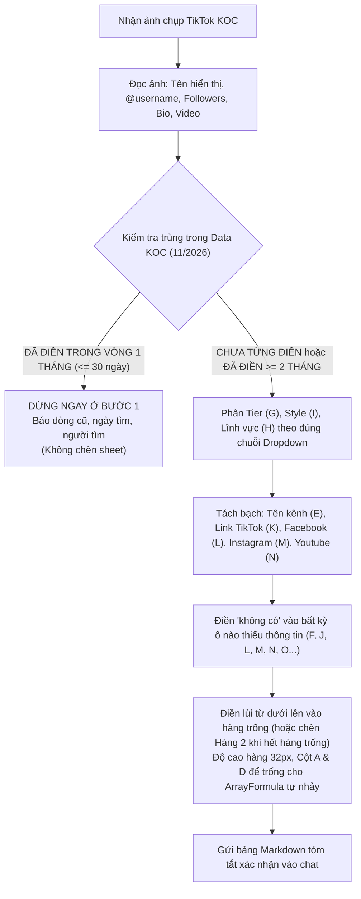

# Workflow 1: Phân Tích Kênh TikTok KOC & Nhập Data

> **Áp dụng**: Mỗi khi người dùng gửi ảnh chụp màn hình kênh TikTok của KOC.
> **Quy tắc thực thi**: Đã hoàn tất testing — **Tự động thực thi 100% không cần hỏi lại xác nhận**.

---

## 1. File Đích & Cấu Hình Mới (Tháng 11/2026)

| Mục | Giá trị |
| :--- | :--- |
| **File** | `[0] KOC Boom (File điền Data)` |
| **Spreadsheet ID** | `1J7pUE_SV-ToO8jNuZZYktu8HsYhYVHVO5GjNwOWJolw` |
| **Tab đích mới** | **`Data KOC (11/2026)`** (sheetId: `280295617`) |
| **Vị trí điền dòng mới** | **Điền lùi tuần tự từ dưới lên trên vào các hàng trống có sẵn** (ví dụ Hàng 9 -> 8 -> 7... đến Hàng 2). Khi hết hàng trống (Hàng 2 đã có data) thì chèn hàng mới tại **Hàng 2** (dưới Header); nếu thêm nhiều KOC cùng lúc thì thêm từ trên xuống (Hàng 2, 3, 4...) |
| **Cột cần điền** | Các cột thông tin từ **B đến Q** (tách thành 2 cụm update riêng: B:C và E:Q) |
| **Cột KHÔNG ĐƯỢC ĐIỀN (Ô màu xanh công thức)** | **Cột A (STT), Cột D (Liên hệ lần thứ), Cột X (Cost SP), Cột Z (Tổng chi phí), Cột AA (Ngày BOOK)**: Tuyệt đối không điền giá trị và không format đè lên để công thức `=ARRAYFORMULA(...)` ở dòng 1 tự nhảy. Giữ nguyên định dạng và chiều cao hàng cố định **`32px`** |
| **Quy tắc "Không có"** | **Chỗ nào không có thông tin thì ghi chữ `không có`, tuyệt đối không bỏ trống ô nào hết** (Ngoại trừ **Cột J Khu vực** nếu không rõ thì để trống `""` để khớp dropdown) |
| **Link trực tiếp** | [Mở Google Sheet Data KOC (11/2026)](https://docs.google.com/spreadsheets/d/1J7pUE_SV-ToO8jNuZZYktu8HsYhYVHVO5GjNwOWJolw/edit?gid=280295617#gid=280295617) |

---

## 2. Sơ Đồ Quy Trình

---

## 3. Quy Tắc Kiểm Tra Trùng (Bước 1)

1. Quét đối chiếu theo **TikTok ID / username** (Cột K & E), **Tên kênh** (Cột E) và **Tên KOC** (Cột F) trong tab `Data KOC (11/2026)`:
   - 🛑 **NẾU ĐÃ ĐIỀN TRONG VÒNG 1 THÁNG ($\le$ 30 ngày)**: **Dừng lại ngay lập tức tại bước 1**, thông báo rõ: dòng trùng, ngày tìm, người phụ trách, dự án đã liên hệ. **Tuyệt đối không chèn thêm dòng mới**.
   - 🔄 **NẾU ĐÃ ĐIỀN CÁCH ĐÂY $\ge$ 2 THÁNG ($\ge$ 60 ngày)**: **Được phép điền lại** (điền/chèn vào Hàng 2 trên cùng, cột D "Liên hệ lần thứ" sẽ tự động nhảy số lần liên hệ mới).
   - ✅ **NẾU CHƯA CÓ TRONG SHEET**: Tiến hành điền mới bình thường.

---

## 4. Chi Tiết Các Cột Cần Điền & Quy Chuẩn "Không Có"

| Cột | Tên cột | Quy tắc điền |
| :---: | :--- | :--- |
| **A** | **STT (Auto)** | 🟢 **Không điền** (ArrayFormula tự tính số thứ tự lớn nhất). |
| **B** | **Người phụ trách** | Mặc định: `Thuận`. |
| **C** | **Ngày tìm** | Ngày hiện tại theo định dạng `d/m/yyyy` (ví dụ: `5/11/2026`). |
| **D** | **Liên hệ lần thứ (Auto)** | 🟢 **Không điền** (ArrayFormula tự đếm số lần liên hệ của kênh). |
| **E** | **Tên kênh** | **Chỉ điền tên hiển thị của kênh TikTok** (ví dụ: `✨ Phi Yen Pham ✨`, `Huaquynhnhu`...) dạng text thuần, không link. **Tuyệt đối KHÔNG kèm ID nhỏ kế bên** (như `\| imneyy`). |
| **F** | **Tên KOC / Nghệ danh** | Điền **Tên thật / Nghệ danh** nếu là người nổi tiếng, hoa hậu, nghệ sĩ, celeb. **Nếu không có thì bắt buộc ghi chữ `không có`**. |
| **G** | **Tệp / nhóm KOC** | **Bắt buộc chọn đúng chuỗi Dropdown**:  • `Mega (Trên 1 TRIỆU followers)` • `Macro (300K đến 1 TRIỆU followers)` • `Micro (10K đến 300K followers)` • `Nano (1K - 10K followers)` |
| **H** | **Ngành / lĩnh vực** | **Bắt buộc chọn đúng chuỗi Dropdown (có dấu cách sau gạch chéo)**: • `Thời trang/ Làm đẹp` • `Nghệ sĩ/ Người nổi tiếng` • `Gia đình/ Nhà cửa đời sống` • `Nhà hàng/ Ăn uống` • `Tài chính/ Cổ phiếu/ Bất động sản` • `Tiếp viên hàng không` • `Hàng xa xỉ` • `Công nghệ` • `Sức khỏe, Fitness` • `MC/Diễn viên/Ca sĩ` • `Couple` • `Model` • `Kinh doanh` |
| **I** | **Style Content** | **Bắt buộc chọn 1 trong 5 chuỗi Dropdown**:  • `Daily Vlog/ Life Style` • `Review` • `Học thuật` • `Tips and tricks` • `Couple` *(Lưu ý: Không dùng "Biến hình/Fashion")* |
| **J** | **Khu vực** | Điền tỉnh/thành phố hợp lệ (`Hà Nội`, `Sài Gòn`, `Đà Nẵng`...). **Riêng cột này nếu quét không ra KOC ở khu vực nào thì ĐỂ TRỐNG** (không ghi "không có" để khớp danh sách dropdown). |
| **K** | **Kênh TikTok** | Link profile TikTok đầy đủ dạng hyperlink (`https://www.tiktok.com/@<username>`). |
| **L** | **Link Facebook** | Link profile / Fanpage Facebook. **Nếu không có thì ghi chữ `không có`**. |
| **M** | **Kênh Instagram** | Link profile Instagram. **Nếu không có thì ghi chữ `không có`**. |
| **N** | **Kênh Youtube** | Link kênh Youtube. **Nếu không có thì ghi chữ `không có`**. |
| **O** | **Contact (Điền chi tiết)** | SĐT/Zalo, Email, Link Bio (mỗi contact xuống dòng). **Nếu không có thì ghi chữ `không có`**. |
| **P** | **Thương hiệu hợp tác** | Mặc định: `Saga`. |
| **Q** | **Dự án đã liên hệ** | Mặc định: `Saga đi tiệc`. |
| **R – Y** | **Các cột Deal & Báo giá** | Để trống khi mới tìm KOC từ ảnh audit (chỉ điền khi phát sinh deal). |
| **X, Z, AA–AQ** | **Cột Auto / Cột thừa cũ** | 🔴 🟢 **Tuyệt đối không đụng vào**. |

---

## 5. Quy Chuẩn Định Dạng Bắt Buộc (Theo Hàng 2 & Hàng 3)

- **Font chữ**: `Nunito`
- **Cỡ chữ**: **`9` (9pt)** *(khớp 100% với Hàng 2 và Hàng 3)*
- **Căn lề (Alignment) & Xuống dòng (Wrap Strategy)**:
  - Cột B, C: Căn giữa (`CENTER`), giữa dòng (`MIDDLE`), wrap: `OVERFLOW_CELL`.
  - Cột E, F: Căn trái (`LEFT`), giữa dòng (`MIDDLE`), wrap: `WRAP`.
  - Cột G, H, I, J: Căn giữa (`CENTER`), giữa dòng (`MIDDLE`), wrap: `WRAP`.
  - Cột K, L, M, N: Căn trái (`LEFT`), giữa dòng (`MIDDLE`), wrap: `CLIP`.
  - Cột O: Căn giữa hoặc trái (`CENTER`/`LEFT`), giữa dòng (`MIDDLE`), wrap: `WRAP`.
  - Cột P, Q: Căn giữa (`CENTER`), giữa dòng (`MIDDLE`), wrap: `OVERFLOW_CELL` hoặc `WRAP`.
- **Thao tác điền**:
  - Nếu Hàng 2 đang trống: điền trực tiếp vào Hàng 2.
  - Nếu Hàng 2 đã có data: chèn 1 hàng mới ngay trên Hàng 2 (startIndex 1) đẩy toàn bộ data xuống dưới, đảm bảo KOC mới luôn nằm ở hàng trên cùng.
