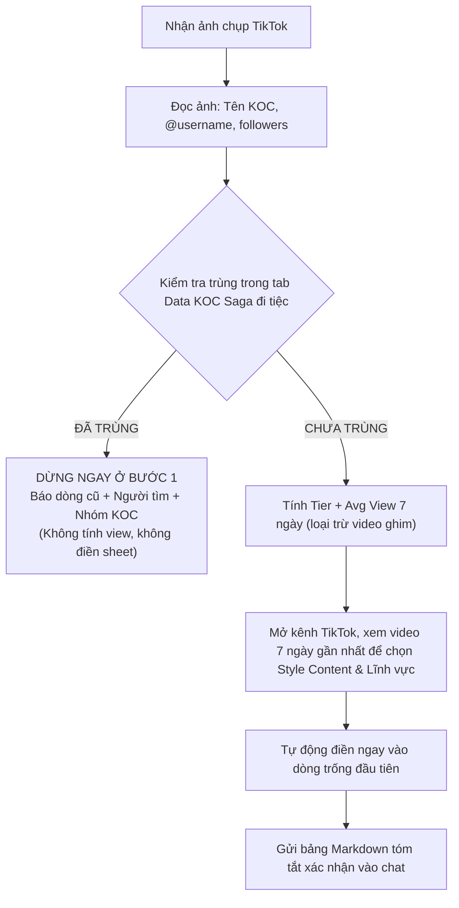

# Workflow 1: Phân Tích Kênh TikTok KOC & Nhập Data

> **Áp dụng**: Mỗi khi người dùng gửi ảnh chụp màn hình kênh TikTok của KOC.
> **Quy tắc thực thi**: Đã hoàn tất testing — **Tự động thực thi 100% không cần hỏi lại xác nhận**.

---

## 1. File Đích & Cấu Hình

| Mục | Giá trị |
| :--- | :--- |
| **File** | `[0] KOC Boom (File điền Data)` |
| **Spreadsheet ID** | `1J7pUE_SV-ToO8jNuZZYktu8HsYhYVHVO5GjNwOWJolw` |
| **Tab đích** | `Data KOC Saga đi tiệc` (sheetId: `1065796303`) |
| **Dòng tiêu đề** | Dòng 7 |
| **Link trực tiếp** | [Mở Google Sheet](https://docs.google.com/spreadsheets/d/1J7pUE_SV-ToO8jNuZZYktu8HsYhYVHVO5GjNwOWJolw/edit?gid=1065796303#gid=1065796303) |

> [!NOTE]
> File nằm trong Shared Drive. Khi tương tác qua Drive API cần bật `supportsAllDrives` / `includeItemsFromAllDrives`.

---

## 2. Sơ Đồ Quy Trình

---

## 3. Các Bước Thực Hiện Chi Tiết

### Bước 1 — Đọc ảnh & Kiểm tra trùng ngay (Dừng nếu trùng)
- **Trích xuất thông tin cơ bản**:
  - Tên hiển thị và **@username** $\rightarrow$ link kênh `https://www.tiktok.com/@<username>`.
  - **Followers**: quy đổi `K` = $\times 1.000$, `M` = $\times 1.000.000$ (ví dụ `265.9K` $\rightarrow$ `265,900`).
- **Kiểm tra trùng ngay lập tức**:
  - Quét cột C của tab `Data KOC Saga đi tiệc`, đối chiếu theo **@username** và **tên hiển thị** (và quét thêm tab cũ để cảnh báo lịch sử nếu có).
  - 🛑 **NẾU ĐÃ TRÙNG**: **Dừng lại ngay lập tức tại bước 1**, báo ngay cho người dùng: số dòng đã có, tên KOC, người tìm trước đó (cột E), nhóm KOC (cột F) và ghi chú cũ. **Tuyệt đối không tính view, không cào thêm và không điền sheet**.
  - ✅ **NẾU CHƯA TRÙNG**: Chuyển tiếp sang Bước 2.

---

### Bước 2 — Phân Tier & Nhóm KOC (Cột F)
Tuân thủ dropdown cột F của Google Sheet:

| Tier | Lượng Followers | Giá trị điền cột F (Nhóm KOC) |
| :--- | :--- | :--- |
| **Nano** | < 30K (1K – 30K) | **`Review/Aff`** *(tự động map)* |
| **Micro** | 30K – 300K | **`Micro`** |
| **Macro** | > 300K – 1M | **`Macro`** |
| **Mega** | > 1M | **`Mega`** |

> [!NOTE]
> KOC dưới 30K followers (Nano) được map tự động vào **`Review/Aff`** để khớp với Data Validation dropdown của sheet. Trong Note đánh giá (cột O) ghi chú rõ Tier Nano.

---

### Bước 3 — Tính Avg View 7 ngày
- Công thức: `Avg View = Tổng view video đăng trong 7 ngày / Số video đó`.
- ⚠️ **Tuyệt đối KHÔNG tính các video được ghim ("Đã ghim")** nếu ngày đăng của chúng không nằm trong vòng 7 ngày gần nhất (vì video ghim thường là video cũ từ nhiều tháng/năm trước để ghim thành tích).
- Nếu ảnh không thể hiện rõ ngày đăng: bỏ qua toàn bộ các video có huy hiệu "Đã ghim", chỉ lấy các video mới nhất không ghim (thường 6–9 video đầu) và ghi rõ số video đã dùng.

---

### Bước 4 — Style Content (Cột G) & Lĩnh Vực (Cột H)
- Mở kênh TikTok, xem nội dung các video **7 ngày gần nhất**.
- Chọn **đúng 1 giá trị có trong dropdown**:
  - **G – Style Content**: `Daily Vlog/Life Style`, `Review`, `Học thuật`, `Tips and tricks`, `Couple`.
  - **H – Lĩnh vực**: `Nghệ sĩ/Người nổi tiếng`, `Kinh doanh`, `Thời trang/Làm đẹp`, `Gia đình/Nhà cửa đời sống`, `Nhà hàng/Ăn uống`, `Tài chính, cổ phiếu, BĐS`, `Hàng xa xỉ`, `Công nghệ`, `Sức khỏe, Fitness`, `MC/Diễn viên/Ca sĩ`, `Couple`, `Model`, `Tiếp viên hàng không`.

---

### Bước 5 — Tự Động Điền Vào Sheet (Không Cần Hỏi Lại)
Ghi tự động vào **dòng trống đầu tiên** của tab **`Data KOC Saga đi tiệc`**:
- **Cột A (STT)**: STT lớn nhất hiện tại + 1 (ghi số nguyên).
- **Cột B (Ngày tìm)**: Ngày hôm nay theo định dạng `dd/mm/yyyy`.
- **Cột C (Tên KOC)**: Tên hiển thị, gắn link kênh qua `textFormat.link` (font Nunito 10).
- **Cột D (Kênh phụ)**: Link Facebook hoặc Instagram (nếu có).
- **Cột E (Người tìm)**: `Thuận` (mặc định).
- **Cột F (Nhóm KOC)**: Nhóm đã map (`Review/Aff`, `Micro`, `Macro`, `Mega`).
- **Cột G (Style Content)**: Đã chọn ở Bước 4.
- **Cột H (Lĩnh vực)**: Đã chọn ở Bước 4.
- **Cột I (Địa điểm)**: Địa điểm hoạt động (nếu có trên bio, vd: `HCM`, `Hà Nội`).
- **Cột J (Thông tin liên hệ)**: Email / Số điện thoại / Zalo / Link Bio.
- **Cột O (Note/Ghi chú)**: `Followers: <x> | Avg View: <y> (<n> video: v1, v2, ...) | Note chi tiết thế mạnh/concept`.

---

### Bước 6 — Trả Kết Quả Tóm Tắt
Đọc lại dòng vừa ghi để xác nhận, sau đó trả về bảng Markdown tóm tắt đầy đủ thông tin vừa điền kèm link dẫn trực tiếp đến sheet.
