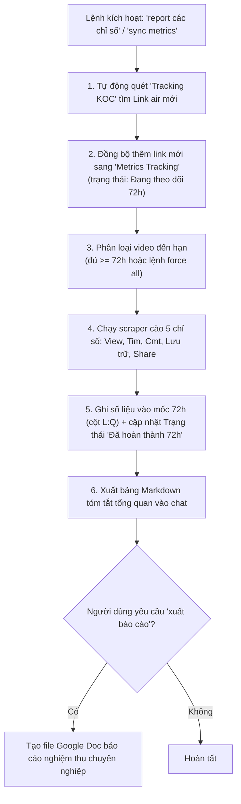

# Workflow 2: Report & Cào Chỉ Số Video KOC (Mốc 72h)

> **Áp dụng khi**: Người dùng yêu cầu *"report các chỉ số"*, *"report chỉ số"*, *"cào view"*, *"cào số"*, *"sync metrics"*, *"cập nhật số liệu"*.
> **Quy tắc thực thi**: Đã hoàn tất testing — **Tự động cào và ghi sheet 100% không cần hỏi lại xác nhận**.

---

## 1. File Đích & Cấu Hình

| Mục | Giá trị |
| :--- | :--- |
| **File** | `[Booking KOC] Tracking sheet` |
| **Spreadsheet ID** | `1-gMFNOq7Z0XXEjC3bXN41XMUNDGW0teC5xGmRizQfgE` |
| **Tab nguồn link** | `Tracking KOC` (cột F: `Link air`) |
| **Tab ghi chỉ số** | `Metrics Tracking` (cột L:Q cho mốc 72h, cột S trạng thái) |
| **Link trực tiếp** | [Mở Google Sheet](https://docs.google.com/spreadsheets/d/1-gMFNOq7Z0XXEjC3bXN41XMUNDGW0teC5xGmRizQfgE/edit#gid=1099201539) |

> [!NOTE]
> **Đã loại bỏ báo cáo mốc 24h**. Hệ thống hiện tại chỉ tập trung cào và cập nhật số liệu nghiệm thu mốc **72h (sau 3 ngày đăng)**.

---

## 2. Sơ Đồ Quy Trình



---

## 3. Các Bước Thực Hiện Chi Tiết

### Bước 1 — Tự Động Đồng Bộ Link Air Mới (Auto-sync Links)
1. Quét cột `Link air` (cột F) từ tab **`Tracking KOC`**.
2. Đối chiếu với danh sách link hiện có ở tab **`Metrics Tracking`**.
3. Nếu phát hiện link air mới: tự động chèn dòng mới vào **`Metrics Tracking`** với Tên KOC, Nền tảng, Link air, Ngày đăng, Trạng thái: `Đang theo dõi 72h`.

---

### Bước 2 — Cơ Chế Cập Nhật Mốc 72h (3 Ngày)
Hệ thống tính `hoursPassed = (Hiện tại - Ngày đăng)`:

| Điều kiện | Mốc cập nhật | Cột ghi trên Google Sheet | Hành động |
| :--- | :--- | :--- | :--- |
| `hoursPassed >= 72` (hoặc không rõ ngày) và chưa hoàn thành | **MỐC 3 NGÀY (72H)** | **L:Q** *(View, Tim, Cmt, Lưu trữ, Share, Updated)* | Cào và ghi nhận đầy đủ 5 chỉ số sau 3 ngày. Trạng thái cột S: `Đã hoàn thành 72h` |
| Người dùng yêu cầu **"report tất cả"** (`--all`) | **MỐC 72H** | Ghi đè chỉ số mới nhất vào **L:Q** | Ép cào lại toàn bộ video bất kể thời gian |

> Bỏ qua bước cào 24h. Cột 24h (F:K) không bắt buộc cập nhật trong workflow này.

---

### Bước 3 — 5 Chỉ Số Được Cào
Hệ thống cào và ghi nhận đầy đủ 5 chỉ số:
1. **View** (Lượt xem video)
2. **Tim** (Lượt thích / Likes)
3. **Comment** (Lượt bình luận)
4. **Lưu trữ** (Saves / Bookmarks / Collect count)
5. **Share** (Lượt chia sẻ)

---

### Bước 4 — Đa Nền Tảng Hỗ Trợ
- **TikTok**: Cào trực tiếp qua Rehydration state/API — lấy đủ 100% 5 chỉ số.
- **Facebook Reels**: Chạy ngầm qua trình duyệt **Playwright Headless** kết hợp session cookie `c_user` và `xs` trong `.env` để lấy Likes, Comment, Share.
- **Instagram / Threads**: Bóc tách qua Meta OpenGraph description & tags.

---

### Bước 5 — Lệnh Thực Thi Kỹ Thuật (CLI Commands)
```bash
# Cào và cập nhật các video đến hạn 72h (kèm tự động kéo link mới từ Tracking KOC)
npm run sync

# Ép cào và cập nhật lại toàn bộ tất cả video mốc 72h
npm run sync:force

# Chạy cron định kỳ ngầm hàng ngày
npm run cron

# Xuất Google Doc báo cáo tổng kết nghiệm thu chiến dịch (chỉ khi có yêu cầu)
npm run export
```

---

### Bước 6 — Đầu Ra Sau Khi Chạy
1. **Trong Chat**: Trả về bảng Markdown tóm tắt nhanh:
   - Tổng số video đã cập nhật.
   - Thống kê tổng mốc 72h: Tổng View, Tổng Tim, Tổng Comment, Tổng Lưu trữ, Tổng Share.
   - Bảng Top 5 video tương tác tốt nhất.
   - Link trực tiếp đến tab `Metrics Tracking`.
2. **Google Doc Báo Cáo Nghiệm Thu**:
   - **Chỉ xuất khi người dùng yêu cầu** (VD: *"xuất báo cáo"*, *"tạo Google Doc báo cáo"*, hoặc lệnh `npm run export`).
