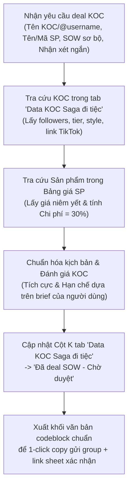

# Workflow 3: Soạn Đề Xuất Deal KOC Gửi Group Duyệt

> **Áp dụng khi**: Người dùng yêu cầu *"viết tin nhắn deal"*, *"soạn tin duyệt deal"*, *"viết proposal deal"*, *"deal KOC gửi group"*, hoặc gửi thông tin deal KOC kèm tên KOC + sản phẩm + SOW.
> **Quy tắc thực thi**: Đã hoàn tất testing — **Tự động tra cứu, tính giá vốn và cập nhật Cột K của sheet 100% không cần hỏi lại**.

---

## 1. Nguồn Dữ Liệu & File Đích

| Mục | Chi tiết |
| :--- | :--- |
| **File Data KOC** | `[0] KOC Boom (File điền Data)` → tab **`Data KOC Saga đi tiệc`** (ID: `1J7pUE_SV-ToO8jNuZZYktu8HsYhYVHVO5GjNwOWJolw`, gid: `1065796303`) |
| **File Bảng giá SP** | `Trang tính1` (ID: `1WYeRjjw_NL-PVQ5URrmKeE7DjqdRduC1aqDoRcvNNfw`, gid: `0`) |
| **Cột cập nhật** | **Cột K (`Tình trạng liên hệ`)**: Tự động ghi `Đã deal SOW - Chờ duyệt` |

---

## 2. Sơ Đồ Quy Trình



---

## 3. Các Bước Thực Hiện Chi Tiết

### Bước 1 — Tiếp Nhận Thông Tin Đầu Vào
Người dùng chỉ cần cung cấp:
1. **Định danh KOC**: Tên KOC hoặc @username hoặc số thứ tự dòng.
2. **Sản phẩm tặng**: Tên mẫu hoặc Mã đồng hồ (ví dụ: `Saga Stella Chance 53578-LGSVLG-2`) hoặc link sản phẩm Hải Triều.
3. **SOW & Kịch bản sơ bộ**: Số lượng video, dạng video (có voice, GRWM, unbox,...).
4. **Nhận xét ngắn về KOC**: Gạch đầu dòng ưu điểm visual, nội dung hoặc hạn chế của kênh.

---

### Bước 2 — Tra Cứu KOC trong tab `Data KOC Saga đi tiệc`
- Dò tìm dòng tương ứng theo tên KOC hoặc @username.
- Lấy: Link TikTok (Cột C), Nhóm KOC (Cột F), Style Content (Cột G), Lĩnh vực (Cột H), Followers và Avg view từ Ghi chú (Cột O).

---

### Bước 3 — Tra Cứu Giá & Tính Chi Phí Sản Phẩm Tặng
- Quét trong file Bảng giá (`1WYeRjjw_NL-PVQ5URrmKeE7DjqdRduC1aqDoRcvNNfw`):
  - Tìm theo Tên BST hoặc Mã sản phẩm trong link sản phẩm (Cột D) hoặc Tên SP (Cột B).
  - Lấy **Giá trị niêm yết** (Cột C).
  - **Tính Chi phí giá vốn** = $30\% \times \text{Giá niêm yết}$.
  - Format chuẩn: `[Tên SP + Mã] trị giá X.XXX.000 đồng (Chi phí Y.YYY.000đ)`.
- *Nếu không tìm thấy sản phẩm trong sheet: Hỏi lại người dùng giá niêm yết.*

---

### Bước 4 — Soạn Thảo Nội Dung Theo Format Chuẩn
- **Lời chào mặc định**: `Hi các chị @Liên Kim @Bích Anh Nguyễn Ngọc hiện tại em đang deal với 1 bạn cho Camp Saga đi tiệc, em nhờ chị xem check giúp em với ạ`
- **Quyền lợi SOW mặc định**: Luôn bao gồm dòng `Bao gồm: Hashtag, tag brand, link sản phẩm/bio; Brand được toàn quyền SDHA`.
- **Cấu trúc mẫu**:
```text
Hi các chị @Liên Kim @Bích Anh Nguyễn Ngọc hiện tại em đang deal với 1 bạn cho Camp Saga đi tiệc, em nhờ chị xem check giúp em với ạ
Thông tin KOC
Tên KOC: [Tên hiển thị] (@[username])
Số followers: [X]K/[X]M TikTok (Tổng [Y]M lượt thích, [Z] video)
Nhóm: [Tier followers] (Followers) / [Tier view] (Views thực tế)
Kịch bản: Gồm [số lượng] video TikTok
Video 1 ([Có voice / Không voice]): [Mô tả chi tiết kịch bản]
Video 2 ([Có voice / Không voice]): [Mô tả chi tiết kịch bản]
Đánh giá KOC:
Tích cực:
(1) [Điểm mạnh visual, thần thái, tệp người xem, sự phù hợp với trang sức/đồng hồ Saga]
(2) [Thế mạnh về phong cách dựng video, nội dung lồng ghép tự nhiên]
Hạn chế: [View thực tế so với follow hoặc tần suất đăng bài]
Sản phẩm tặng: [Tên BST + Mã sản phẩm] trị giá [X.XXX.000] đồng (Chi phí [Y.YYY.000]đ)
Kênh air thành phẩm
TikTok: [Link TikTok KOC]
SOW đã deal
[Danh sách các video deal]
Bao gồm: Hashtag, tag brand, link sản phẩm/bio; Brand được toàn quyền SDHA
```

---

### Bước 5 — Tự Động Cập Nhật Sheet & Trả Kết Quả
1. Mở tab **`Data KOC Saga đi tiệc`**, định vị đúng dòng KOC.
2. Cập nhật **Cột K (`Tình trạng liên hệ`)** = `Đã deal SOW - Chờ duyệt` (giữ nguyên các cột khác).
3. Trả về khối văn bản codeblock trong chat để 1-click copy gửi group kèm link xác nhận dòng trang tính vừa cập nhật.
