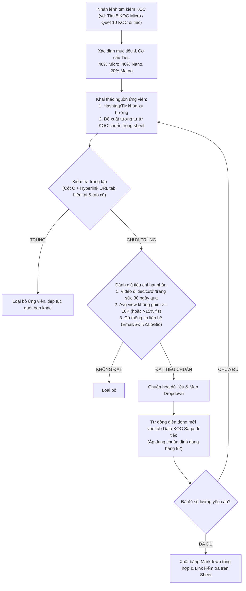

# Workflow 5: Tự Động Tìm Kiếm & Khai Thác Data KOC (KOC Autonomous Discovery)

> **Áp dụng**: Khi người dùng yêu cầu tìm kiếm KOC mới (vd: *"Tìm giúp tôi 5 KOC Micro"*, *"Quét 10 KOC theo tiêu chí Saga"*, *"Tự tìm KOC đi tiệc"*...).
> **Quy tắc thực thi**: Đã thống nhất thiết kế — **Tự động thực thi 100% từ quét, lọc, kiểm tra trùng đến điền thẳng vào sheet và báo cáo tổng kết**.

---

## 1. File Đích & Cấu Hình

| Mục | Giá trị |
| :--- | :--- |
| **File** | `[0] KOC Boom (File điền Data)` |
| **Spreadsheet ID** | `1J7pUE_SV-ToO8jNuZZYktu8HsYhYVHVO5GjNwOWJolw` |
| **Tab đích** | `Data KOC Saga đi tiệc` (sheetId: `1065796303`) |
| **Dòng tiêu đề** | Dòng 7 |
| **Người tìm Data mặc định** | `Thuận` |
| **Chuẩn định dạng** | Học theo hàng 92: Font `Nunito`, size `10`, `wrapStrategy: 'WRAP'`, căn lề chuẩn, link đính kèm, để trống cột I nếu không có tỉnh/thành. |

---

## 2. Sơ Đồ Quy Trình Khai Thác Tự Động

---

## 3. Các Tiêu Chuẩn & Bộ Lọc Hạt Nhân (Scoring & Filtering Criteria)

### A. Nguồn Khai Thác Ứng Viên (Candidate Sourcing)
1. **Hashtag & Keyword Trọng Điểm**:
   - `#outfitditiec`, `#grwmditiec`, `#damditiec`, `#phoidoditiec`, `#diendamditiec`
   - `#trangsuc`, `#reviewtrangsuc`, `#trangsuccaocap`, `#phukientrangsuc`
   - `#vlogcuoi`, `#chuanbicuoi`, `#tieccuoi`, `#codau`
   - `#goclamdep`, `#beautyreview`, `#lifestylevlog`
2. **Đào sâu KOC tương tự (Suggested Creators)**:
   - Quét từ danh sách "Tài khoản được đề xuất" của các KOC đã chốt book hoặc có visual xuất sắc trong sheet (như `@chichiichill`, `@220900n`, `@hazel.ttn`, `@maiithuha`, `@nicoletran216`, `@salimhwg`).

### B. Cơ Cấu Phân Bổ Tier (Mặc định khi yêu cầu tổng số lượng)
- **Micro (30K – 300K)**: Chiếm **40%** (Phân khúc trọng điểm, tỷ lệ tương tác & chuyển đổi tối ưu).
- **Nano (10K – 30K)**: Chiếm **40%** (Map dropdown cột F: `Review/Aff`, ưu tiên barter deal tặng sản phẩm).
- **Macro (>300K – 1M)**: Chiếm **20%** (Tạo độ phủ thương hiệu và uy tín visual).

### C. Tiêu Chí Đánh Giá Bắt Buộc (Must-Have Criteria)
1. **Nội dung gần nhất**: Phải có ít nhất 1 video về OOTD đi tiệc / dự tiệc cưới / review trang sức / phối đồ sang trọng / GRWM sự kiện trong vòng **30 ngày gần nhất**.
2. **Hiệu suất tương tác (Avg View 7 ngày / Video không ghim)**:
   - Tối thiểu **10.000 view** (hoặc tỷ lệ view trung bình đạt trên **15%** lượng follower).
   - Tuyệt đối loại bỏ các video được ghim ("Đã ghim") khi tính view trung bình.
3. **Kênh liên hệ**: Bắt buộc có thông tin liên hệ công việc rõ ràng trong Bio (Email công việc, SĐT/Zalo quản lý, hoặc Link Bio Beacons/Passio/Linktree).

---

## 4. Chuẩn Hóa Dữ Liệu & Quy Tắc Nhập Sheet

### A. Map Dropdown Chuẩn Xác:
- **Cột F (Nhóm KOC)**:
  - `< 30K` $\rightarrow$ `Review/Aff` (Ghi chú rõ Tier Nano trong Cột O).
  - `30K – 300K` $\rightarrow$ `Micro`.
  - `> 300K – 1M` $\rightarrow$ `Macro`.
  - `> 1M` $\rightarrow$ `Mega`.
- **Cột G (Style Content)**: Đúng giá trị: `Daily Vlog/Life Style`, `Review/Tips`, `Biến hình/Fashion`, `Tâm sự/Storytelling`, `Tiểu phẩm/Hài`, `Khác`.
- **Cột H (Lĩnh vực)**: Đúng giá trị: `Thời trang/Làm đẹp`, `Nghệ sĩ/Người nổi tiếng`, `Gia đình/Nhà cửa đời sống`, `Kinh doanh`, `Đời sống`, `Khác`.
- **Cột I (Địa điểm)**:
  - Chỉ điền khi tìm thấy tỉnh/thành phố rõ ràng có trong dropdown (`Hà Nội`, `Sài Gòn`, `Bình Dương`, `Đắk Lắk`, `Cần Thơ`, `Đà Nẵng`...).
  - Nếu ghi `HCM` hoặc `Hồ Chí Minh` $\rightarrow$ Map thành `Sài Gòn`.
  - **Nếu không rõ hoặc chỉ ghi "Việt Nam" $\rightarrow$ Bắt buộc ĐỂ TRỐNG (`""`)**.

### B. Quy Chuẩn Định Dạng Hàng 92 (Bắt buộc 100%):
- **Font chữ**: `Nunito`, cỡ chữ `10`.
- **Xuống dòng tự động**: Bật `wrapStrategy: 'WRAP'` cho toàn bộ các ô để hiển thị đầy đủ, không tràn hay cắt cụt chữ.
- **Căn lề**:
  - Căn giữa (`CENTER`), giữa ô (`MIDDLE`): Cột A (STT), B (Ngày), E (Người tìm), F (Nhóm), G (Style), H (Lĩnh vực), I (Địa điểm), K, L, M, N.
  - Căn trái (`LEFT`), giữa ô (`MIDDLE`): Cột C (Tên KOC kèm hyperlink), D (Kênh phụ kèm hyperlink), J (Liên hệ), O (Ghi chú).

---

## 5. Báo Cáo Kết Quả

Sau khi điền đủ số lượng KOC yêu cầu, Agent xuất bảng Markdown tóm tắt:
1. Danh sách KOC đã tìm và thêm mới (STT, Tên, Tier, Followers, Style, Điểm mạnh).
2. Tỷ lệ cơ cấu Tier đạt được.
3. Link dẫn trực tiếp đến các dòng vừa điền trên Google Sheet để người dùng kiểm tra nhanh.

