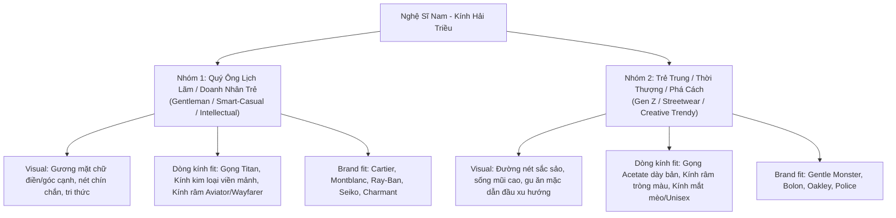

# Workflow 6: Tìm Kiếm & Đề Xuất Nghệ Sĩ Nam - Kính Hải Triều (Male Artist Booking)

> **Áp dụng**: Khi người dùng yêu cầu tìm kiếm, sàng lọc hoặc lập danh sách nghệ sĩ nam / talent nam để booking cho thương hiệu **Kính Hải Triều** (vd: *"Tìm 5 nghệ sĩ nam cho Kính Hải Triều"*, *"Đề xuất celeb nam đeo kính cận/kính mát"*, *"Quét talent nam phong cách lịch lãm/thời trang cho Kính Hải Triều"*...).
> **Mục tiêu**: Tuyển chọn các nghệ sĩ, diễn viên, người mẫu, MC hoặc fashionista nam có visual sáng, đường nét gương mặt góc cạnh, phong cách thời trang định hình rõ rệt, hình ảnh sạch, tôn lên vẻ đẹp và đẳng cấp của các dòng sản phẩm Kính Hải Triều.

---

## 1. Thông Tin & File Lưu Trữ

| Mục | Chi tiết |
| :--- | :--- |
| **Dự án** | **Kính Hải Triều** (Hệ thống showroom & phân phối mắt kính chính hãng cao cấp) |
| **File đích** | File Google Sheet quản lý Kính Hải Triều / Tab `Data Nghệ Sĩ Nam - Kính HT` |
| **Spreadsheet ID mặc định** | `1J7pUE_SV-ToO8jNuZZYktu8HsYhYVHVO5GjNwOWJolw` (hoặc file riêng dự án Kính Hải Triều khi được cấu hình) |
| **Người tìm / Phụ trách** | `Thuận` |
| **Hình thức hợp tác** | Barter (tặng kính chính hãng cao cấp), Paid Booking (quay video/chụp ảnh lookbook), Ghé showroom đo mắt & trải nghiệm |

---

## 2. Tiêu Chuẩn & Chân Dung Nghệ Sĩ Nam Mục Tiêu (Target Persona)

### A. Lĩnh Vực Hoạt Động (Fields)
- **Diễn viên** (Điện ảnh, truyền hình, web-drama, sân khấu): Có khả năng diễn xuất tự nhiên trước ống kính, hình tượng nhân vật đa dạng.
- **Ca sĩ / Rapper / Nhạc sĩ**: Có chất riêng, phong cách biểu diễn cuốn hút, lượng fan trung thành.
- **Người mẫu nam / Nam vương**: Chiều cao tốt, tỷ lệ cơ thể và thần thái chụp lookbook/editorial chuẩn thời trang.
- **MC / Host / BTV truyền hình**: Ngoại hình chỉn chu, giọng nói chuẩn, phong thái tri thức, uy tín.
- **Fashionista / Stylist / Content Creator Thời Trang Nam**: Gu thẩm mỹ cao, biết cách mix-match trang phục với phụ kiện mắt kính.

### B. Hai Nhóm Phong Cách Trọng Tâm (Style Archetypes)

1. **Nhóm 1: Quý Ông Lịch Lãm / Doanh Nhân / Tri Thức (Gentleman & Intellectual)**:
   - **Gương mặt**: Khuôn mặt góc cạnh, sống mũi cao, cằm chữ điền hoặc V-line chững chạc, ánh mắt có chiều sâu.
   - **Phục trang thường ngày**: Sơ mi, suit/vest, blazer, polo thanh lịch, tone màu trung tính (đen, trắng, xám, navy, be).
   - **Dòng kính phù hợp**:
     * Gọng kính cận Titanium siêu nhẹ, gọng mạ vàng/bạc viền thanh mảnh tôn nét trí thức.
     * Kính mát dáng phi công (Aviator), dáng chữ nhật cổ điển (Wayfarer) sang trọng.
   - **Thương hiệu tham chiếu tại Kính Hải Triều**: Cartier, Montblanc, Ray-Ban, Seiko, Silhouette, Rodenstock.

2. **Nhóm 2: Trẻ Trung / Trendy / Phá Cách (Creative & Modern Lifestyle)**:
   - **Gương mặt**: Visual sắc sảo, thần thái cuốn hút, da sáng, đường nét cá tính.
   - **Phục trang thường ngày**: Streetwear, minimalism, retro/vintage, áo khoác da, phụ kiện layer.
   - **Dòng kính phù hợp**:
     * Gọng kính Acetate dày dặn, gọng mắt mèo (cat-eye nam), gọng vuông phá cách.
     * Kính mát tròng màu (vàng, cam, xanh trà), kính thể thao thể hiện chất riêng.
   - **Thương hiệu tham chiếu tại Kính Hải Triều**: Gentle Monster, Bolon, Oakley, Police, Ray-Ban Reverse.

---

## 3. Bộ Lọc Chất Lượng & Uy Tín (Strict Quality Guardrails)

1. **Hình ảnh sạch (Brand Safety)**:
   - Lý lịch nghệ thuật tốt, không vướng scandal về đạo đức, đời tư hoặc pháp luật.
   - Phát ngôn trên mạng xã hội văn minh, chuẩn mực.
2. **Hiệu suất & Tương tác thực (True Engagement)**:
   - Có bài đăng/hình ảnh/video hoạt động đều đặn trong 30–60 ngày gần nhất.
   - Tương tác tự nhiên (lượng comment từ fan thật, tỷ lệ tương tác lành mạnh).
3. **Mức độ "Ăn ảnh" khi đeo kính (Eyewear Fit)**:
   - Đã từng có shoot ảnh hoặc video đeo kính nhận được nhiều lời khen từ khán giả.
   - Tỷ lệ khoảng cách giữa 2 mắt, sống mũi và gò má hài hòa, dễ tôn dáng các loại gọng kính.
4. **Thông tin Booking rõ ràng**:
   - Có email booking, SĐT người đại diện (Manager) hoặc công ty quản lý trong Bio/kênh thông tin chính thức.

---

## 4. Dữ Liệu Cần Thu Thập & Lập Bảng Đề Xuất

Khi đề xuất danh sách nghệ sĩ nam, cung cấp đầy đủ các trường thông tin chuẩn hóa:

| Cột | Trường thông tin | Hướng dẫn thu thập |
| :---: | :--- | :--- |
| **1** | **STT** | Số thứ tự tăng dần |
| **2** | **Họ tên & Nghệ danh** | Tên nghệ danh (kèm tên thật nếu có) |
| **3** | **Lĩnh vực hoạt động** | Diễn viên / Ca sĩ / Người mẫu / MC / Stylist |
| **4** | **Phân nhóm phong cách** | `Lịch lãm / Tri thức` hoặc `Trẻ trung / Phá cách` |
| **5** | **Kênh chính & Link** | Link TikTok, Instagram, Facebook Fanpage |
| **6** | **Quy mô tiếp cận** | Lượng Follower các kênh chính (Celeb >1M, Macro 300K-1M, Talent 50K-300K) |
| **7** | **Đặc điểm gương mặt & Visual** | Mô tả ngắn: Khuôn mặt, sống mũi, thần thái chụp ảnh |
| **8** | **Gợi ý dòng kính Kính Hải Triều** | Loại kính phù hợp nhất (Gọng Titan doanh nhân / Kính mát thời trang / Kính Acetate trendy) |
| **9** | **Thông tin liên hệ Booking** | Tên Quản lý, SĐT/Zalo, Email liên hệ công việc |
| **10** | **Đánh giá Brand Fit** | Nhận xét 1–2 câu lý do bạn này phù hợp nhất với Kính Hải Triều |

---

## 5. Quy Trình Thực Thi

1. **Bước 1: Tiếp nhận yêu cầu & Số lượng**: Xác định số lượng nghệ sĩ cần tìm và phân khúc phong cách mong muốn (hoặc cân bằng 50% Lịch lãm - 50% Trendy).
2. **Bước 2: Quét & Đánh giá ứng viên**: Khai thác qua TikTok/Instagram, chọn lọc gương mặt có visual sáng và gu thời trang chuẩn.
3. **Bước 3: Kiểm tra Brand Safety & Eyewear Fit**: Thẩm định hình ảnh sạch, xem xét các góc nghiêng và hình ảnh đeo kính thực tế.
4. **Bước 4: Xuất báo cáo đề xuất**: Trình bày bảng Markdown chuẩn hóa, phân loại rõ ràng và gợi ý concept chụp hình/quay video phù hợp.
5. **Bước 5: Lưu dữ liệu**: Điền vào tab/sheet quản lý Kính Hải Triều theo đúng định dạng chuẩn.
